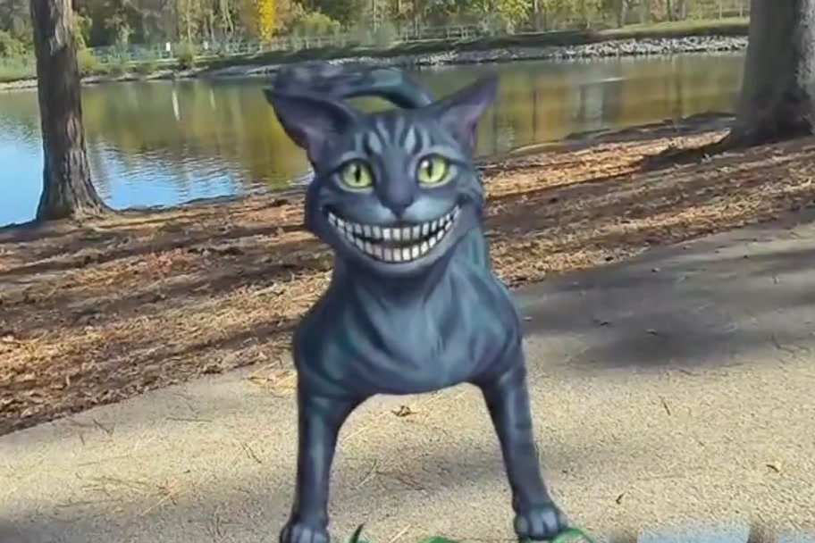

# Wonder: AWAKE

The White Rabbit offers you his watch. By the time you meet the Queen, she has a story to tell about the choices you made.

ARt Emerged Studios built this seated mixed reality experience for Meta Quest 3 for the Entertainment track of the Meta VR Start Developer Competition 2026. Visitors reach with their hands, speak to the characters if they wish, and can touch a little star to ask for help.

[Open Rabbit’s interactive storybook](https://wonder-awake-storybook.iamptah.chatgpt.site/) · [Read the final PDF](https://wonder-awake-storybook.iamptah.chatgpt.site/Wonder-AWAKE-Storybook.pdf?v=final)

## Inside the Queen’s story

The [C# source sample](CourtMemorySnapshot.cs) shows how the Quest project chooses details for the Queen’s story card. A butterfly can be recalled after it lands. At Hatter’s table, the record distinguishes a visitor choosing to turn back time from a choice made with Wonderland’s help.

This file is an excerpt from the Unity project and references its scene classes. The headset experience is distributed separately through Meta.
